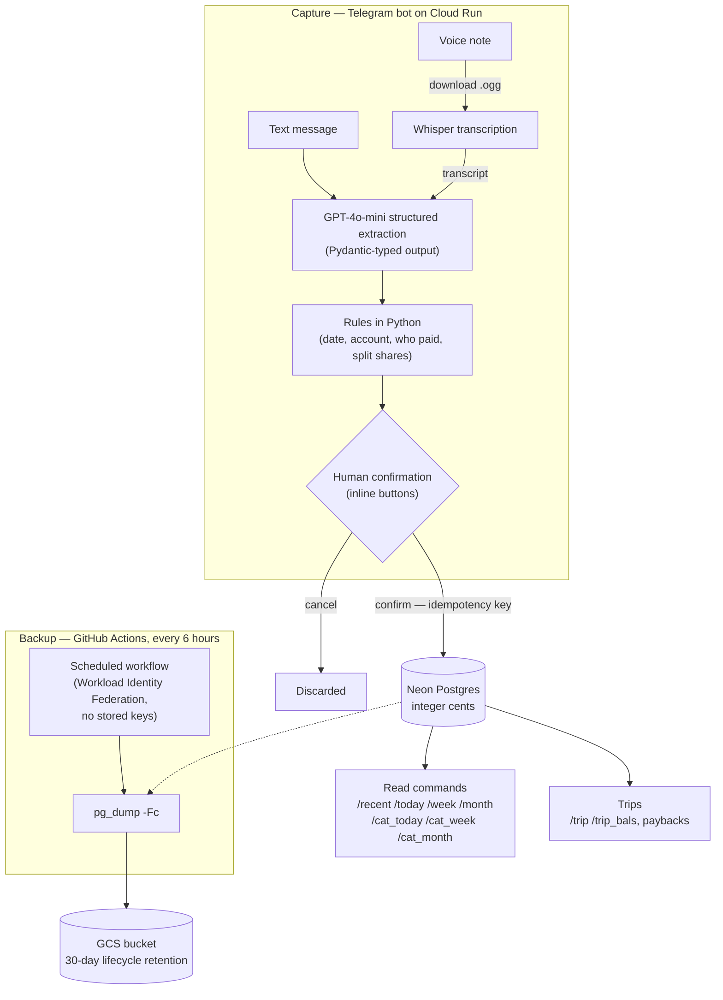

# Unified Ledger Pipeline

A household expense ledger. You send a Telegram bot a voice note or a typed message, it turns
that into a structured entry, you check it and tap Confirm, and it lands in a multi-currency
Postgres ledger.

## The problem

Household spending is spread across two people, several banks and cards, and more than one
currency. An expense that isn't written down when it happens usually isn't written down at all.
Spreadsheets lose because they take effort. Raw voice or text notes lose because they have no
structure: an amount, a currency, a category, a card and an owner all have to be pulled out of
a sentence like *"nine eighty for lunch on the OCBC card"* before the entry is worth keeping.

This project is the capture side of that problem, built as a small data pipeline. Voice and
text both feed one extraction and checking step, a person confirms every entry before anything
is written, and a Postgres ledger is the single source of truth. Matching that ledger against
real bank statements is the next phase; see [What's next](#whats-next).

## Architecture



**Ingestion.** There are two ways in, and they meet straight away. A voice note is downloaded
and transcribed with OpenAI Whisper; a text message is used as it is. From there both are plain
text, handled by `process_expense_text` in `app/bot_core.py`. GPT-4o-mini, at temperature 0 and
with Pydantic-typed structured output, reads the amount, currency, category, card, what was said
about the date ("yday", "last tues", "3/7"), and who shares the bill. It never does maths. Tested
Python then works out the date, the account, who paid and each person's share. Nothing is
written until someone taps Confirm, so a person always checks the model's work before it reaches
the ledger. Photos, stickers and documents get a reply saying they aren't supported, rather than
silence.

**Transport and logic are separate.** `app/bot_core.py` holds all the handlers and logic but
never starts a network loop. `app/bot_local.py` runs it as a local polling loop against a
separate test bot. `app/bot_webhook.py` wraps the same code in FastAPI behind `POST /webhook` for
Cloud Run, where idle containers sleep and polling doesn't work.

**Storage.** Neon Postgres through a pooled SQLAlchemy Core engine. Money is always stored as
integer cents, converted from dollars by one shared function using exact decimal maths (half a
cent rounds up), so float rounding never reaches a stored amount. Alembic owns the schema; there
is no `CREATE TABLE` in application code. Totals are grouped by currency, and nothing converts
between currencies.

**Backups.** Neon's free tier can only roll back the last 6 hours, so a separate backup runs from
GitHub Actions every 6 hours: `pg_dump -Fc` to a GCS bucket that keeps 30 days. It signs in with
Workload Identity Federation, so this public repo holds no long-lived cloud credential. The
restore steps are written down and have been tried; see
[`docs/BACKUP_RESTORE.md`](docs/BACKUP_RESTORE.md).

## Key decisions & tradeoffs

Every significant decision is an ADR in [`docs/decisions/`](docs/decisions/), with its context,
the options turned down, and what it cost. The ones that shaped the system most:

- **Money as integer cents, never floats**
  ([ADR-0004](docs/decisions/0004-money-as-integer-cents.md),
  [ADR-0028](docs/decisions/0028-exact-cent-conversion-half-up.md)). Dollars appear only at the
  edges, through one function with exact decimal maths, and every card shows the amount from the
  same cents that get saved. It costs a conversion step everywhere and buys exact arithmetic on
  money.
- **Neon Postgres over SQLite, with hand-written Alembic migrations**
  ([ADR-0005](docs/decisions/0005-neon-postgres-over-sqlite.md),
  [ADR-0007](docs/decisions/0007-alembic-hand-written-migrations.md)). A file database can't
  serve a Cloud Run container or data meant to last years. Migrations are hand-written because
  the project uses SQLAlchemy Core, not the ORM, so there's nothing for autogenerate to compare.
- **Transport split from logic**
  ([ADR-0003](docs/decisions/0003-split-bot-transport-from-logic.md)). The same handler code runs
  under local polling and the production webhook, so deployment details never leak into the
  logic.
- **The model reads, Python decides**
  ([ADR-0030](docs/decisions/0030-llm-reads-dates-python-resolves.md),
  [ADR-0039](docs/decisions/0039-splits-read-by-the-model-worked-out-by-python.md),
  [ADR-0049](docs/decisions/0049-prompt-holds-only-what-python-cant-read.md)). The model says what
  the message means ("last tues", "split with Carol"); tested Python turns that into a date or
  whole-cent shares. Anything Python can read from the words itself, it does, and the prompt
  holds only what it can't.
- **The raw input is the description, not an LLM summary**
  ([ADR-0008](docs/decisions/0008-raw-transcript-as-description.md)). Earlier versions stored a
  model-written summary, which drifted into other languages. Keeping the user's own words is
  boring and reliable, and keeps the source text for re-reading later.
- **Idempotent saves via an explicit key**
  ([ADR-0011](docs/decisions/0011-idempotency-key-over-update-id.md)). The Confirm button carries
  an idempotency key with `ON CONFLICT DO NOTHING`, so a double tap can't save twice. Chosen over
  storing Telegram's `update_id`, which solves a bigger problem this volume doesn't have yet.
- **Backups scheduled from GitHub Actions, with keyless auth**
  ([ADR-0012](docs/decisions/0012-github-actions-over-cloud-scheduler.md),
  [ADR-0013](docs/decisions/0013-workload-identity-federation.md),
  [ADR-0014](docs/decisions/0014-pg-dump-custom-format.md)). The schedule lives in the repo where
  it can be reviewed, not as hidden cloud config, and the public repo holds no long-lived key.

## What's live today

**Logging an entry**

- Voice and text capture through the Telegram bot, running on Cloud Run.
- Every entry is shown as a card first and saved only on Confirm, once, even if Confirm is
  tapped twice.
- Dates in plain words, spoken or typed ("yday", "last tues", "3/7"). The model says what was
  said and tested Python works out the date. The card warns when a date looks wrong (in the
  future, more than 60 days back, or not understood), but you can still save it.
- A warning before saving something that looks like an entry from the last 5 minutes (same
  amount and currency, logged by anyone in the household). It says who logged it when that's
  known. You can save anyway or cancel.
- `/help` shows how to word an entry, as topic buttons: splitting, splitting by nights, who
  paid, and dates. Every example in it is checked against the real model.

**People and cards**

- Who may use the bot, and the cards they pay with, are rows in Postgres (`participants` and
  `accounts`), read on every message, so a new card works without a redeploy. If those rows
  can't be read, nobody gets in. A cancelled card keeps its name, and an entry on it asks before
  saving.
- Who paid is read from the message ("Bob paid", "paid by Carol"). If Python can't find a payer
  but the message has a paying word ("Carol covered dinner"), the model's reading is used and
  the card says "Read as: Carol paid. Check." A card with an owner decides who paid. An entry
  paid by someone outside the household goes on a shared "Paid by someone else" account and
  stays out of the household totals.
- A "Change who paid" button lists people to tap: the trip's members while the entry is on a
  trip, otherwise everyone the bot knows. If no account fits the person tapped, nothing changes.

**Splits**

- Say who shares a bill in plain words: "split with Carol", "split between Alice's and Bob's
  families", "split between everyone except Dave". "With" includes you; "between" doesn't. The
  model reads only who. Python matches the names and hands out whole cents that add up to the
  amount. The card shows every share before Confirm, and the shares are saved with the entry. A
  name it can't match is a warning line, never a guess.
- An "Add split" button opens a menu to tick people, or a whole family in one tap while the
  entry is on a trip. The card redraws with each tap.
- Uneven shares by a count per person, like nights ("Airbnb 900 split by nights. Reds 5 nights,
  rest all 6 nights."). Python checks that each number is really in the message. A count read
  loosely gets a "⚠️ Check …" line.
- Exact amounts are typed, not read from the message. "Set amounts" sends a reply prompt, and
  Python reads replies like "Bob 90". Anyone not set shares what's left, so the card always adds
  up. The prompt and replies are tidied away once read
  ([ADR-0048](docs/decisions/0048-exact-split-amounts-by-reply.md)).

**Trips and settling up**

- `/trip` lists your trips as buttons. Tap one and every entry you log is tagged to it until you
  turn trip mode off. Each person has their own switch, and a banner is pinned in your chat
  while it's on. The card shows the trip, with a button to leave a single entry out of it.
- `/trip_bals` shows who owes whom on a trip, worked out from the saved splits: a balance per
  family and per currency, and a short list of payments that settles it. Money goes back to the
  person who paid the bill. It's plain text, so it can be forwarded to the group.
- Paybacks: a "Mark paid" button under each suggested payment opens a payback card, saved only on
  Confirm. You can type a different amount, and the money handed over can be in another
  currency. A payback is its own record, never spending. Paying more than is owed gets a warning
  and a "Confirm overpayment" button, not a refusal.

**Reading the ledger**

- `/recent` (the last 5 entries), `/today`, `/week`, `/month` and a per-category version of each,
  totalled per currency.

**Keeping it running**

- CI on every pull request: a clean install, lint, an import check across `app/`, and a pytest
  suite of over a thousand tests that never touches the network or a database. A repository
  ruleset blocks any merge to `main` that fails.
- `pg_dump` backups to GCS every 6 hours, kept 30 days. The restore steps were tried on
  2026-08-13.
- A small FastAPI REST API (`GET/POST /transactions`, `app/main.py`) for adding entries from code.
  It runs locally only, and POST must name an open account.

## What's next

What's coming is tracked in [`ROADMAP.md`](ROADMAP.md):

- **Undoing a saved entry** from Telegram, and linking each payback to the bill it paid off.
- **Reconciliation engine** (Phase 1): read PDF bank statements
  ([ADR-0016](docs/decisions/0016-pdf-statements-over-csv.md)) into a staging table and match
  them to ledger entries with step-by-step rules. A line is matched automatically only when
  there's exactly one candidate; anything unclear goes to review
  ([ADR-0015](docs/decisions/0015-deterministic-matching-before-llm.md)).
- **Evaluation harness** (Phase 2): a hand-labelled set of statement lines and the ledger entries
  they should match, scored for precision and recall, used to tune the matcher instead of
  guessing its settings.

## Getting started

Run everything from the repo root (imports use the `app.` prefix via implicit namespace
packages).

```bash
pip install -r requirements.txt

# Create the tables (transactions, participants, accounts, trips, trip_members,
# transaction_splits and settlements). This targets DATABASE_URL from .env; to migrate a test
# branch instead, see docs/LOCAL_TESTING.md.
alembic upgrade head

# Run the bot locally against a separate test bot (reads .env.local over .env). Recommended;
# see docs/LOCAL_TESTING.md. Polling with the production token deletes the live webhook.
python -m app.bot_local

# Run the production-style webhook server locally
uvicorn app.bot_webhook:app_fastapi --reload --port 8080

# CLI expense entry / terminal ledger view
python -m app.add_expense --date 2026-07-29 --desc "Lunch" --amount 12.50 --cat Food --account "Card A"
python -m app.view_ledger
```

Deployment: the `Dockerfile` installs `requirements.txt` and runs
`uvicorn app.bot_webhook:app_fastapi --host 0.0.0.0 --port 8080` (Cloud Run).

### Required environment (`.env`, loaded via `python-dotenv`)

- `TELEGRAM_BOT_TOKEN`
- `OPENAI_API_KEY`
- `DATABASE_URL`: the Postgres connection string (`postgresql+psycopg://...`)
- `WEBHOOK_URL`: optional, only used by `bot_webhook.py` to register the Telegram webhook.
- `WEBHOOK_SECRET_TOKEN`: required whenever `WEBHOOK_URL` is set. It's registered with Telegram
  at startup, and `/webhook` rejects any request that doesn't send it back in Telegram's
  `X-Telegram-Bot-Api-Secret-Token` header.

Who may use the bot, and the cards they pay with, aren't settings: they're rows in the
`participants` and `accounts` tables, read on every message. If those tables can't be read, the
bot lets nobody in. `scripts/seed_directory.py` fills them from a gitignored JSON file in the
format of `directory_seed.example.json`.

## Docs

- [`docs/decisions/`](docs/decisions/): numbered Architecture Decision Records, saying why each
  choice was made, what was turned down, and what it cost
- [`docs/SCHEMA.md`](docs/SCHEMA.md): the schema reference
- [`docs/BACKUP_RESTORE.md`](docs/BACKUP_RESTORE.md): how often backups run, how long they're
  kept, and how to restore one
- [`docs/LOCAL_TESTING.md`](docs/LOCAL_TESTING.md): running the bot locally against a separate
  test bot, without touching the live one
- [`ROADMAP.md`](ROADMAP.md): current phase, status and plan
