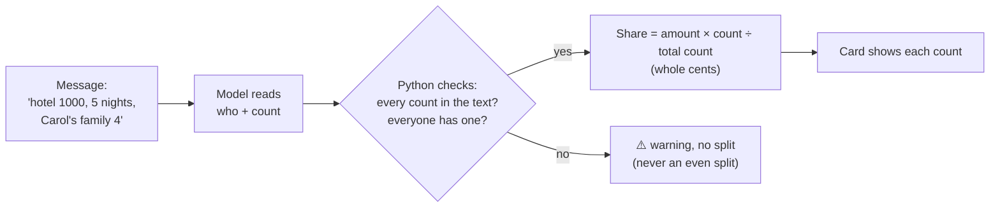

# ADR-0042: Uneven shares by a count per person

**Status:** Accepted (edited 2026-11-18)
**Date:** 2026-11-16
**Code:** `app/services/splits.py`, `app/services/extraction.py::SplitReference`

> **Edited 2026-11-18:** this first said uneven shares were "counts only". Wrong: counts are for
> things like hotel nights. Exact amounts per person come with
> [#112](https://github.com/sujayjangam/unified-ledger-pipeline/issues/112).

## Problem

Splits were always even. On a 5-night booking, a family that stayed 4 nights should pay less.

## Decision

- The model only reads names and counts. Python checks every count against the message and does
  the maths.
- Only cents are saved; the counts stay in the message text. No migration.

Why Python checks: in testing, the model dropped people or invented counts too often (for
example, plain "except" exclusions lost in 3 of 5 runs). Test runs are in PR
[#106](https://github.com/sujayjangam/unified-ledger-pipeline/pull/106) and
`scripts/check_extraction.py`; the full rule list is in `CLAUDE.md` and this file's git history.

## Rejected

- **Two entries for one booking:** one charge should stay one entry, to match the statement.
- **A weight column in the database:** needed a migration during the deploy freeze.
- **Any menu tap makes the split even:** adding one person would quietly wipe everyone's nights.
