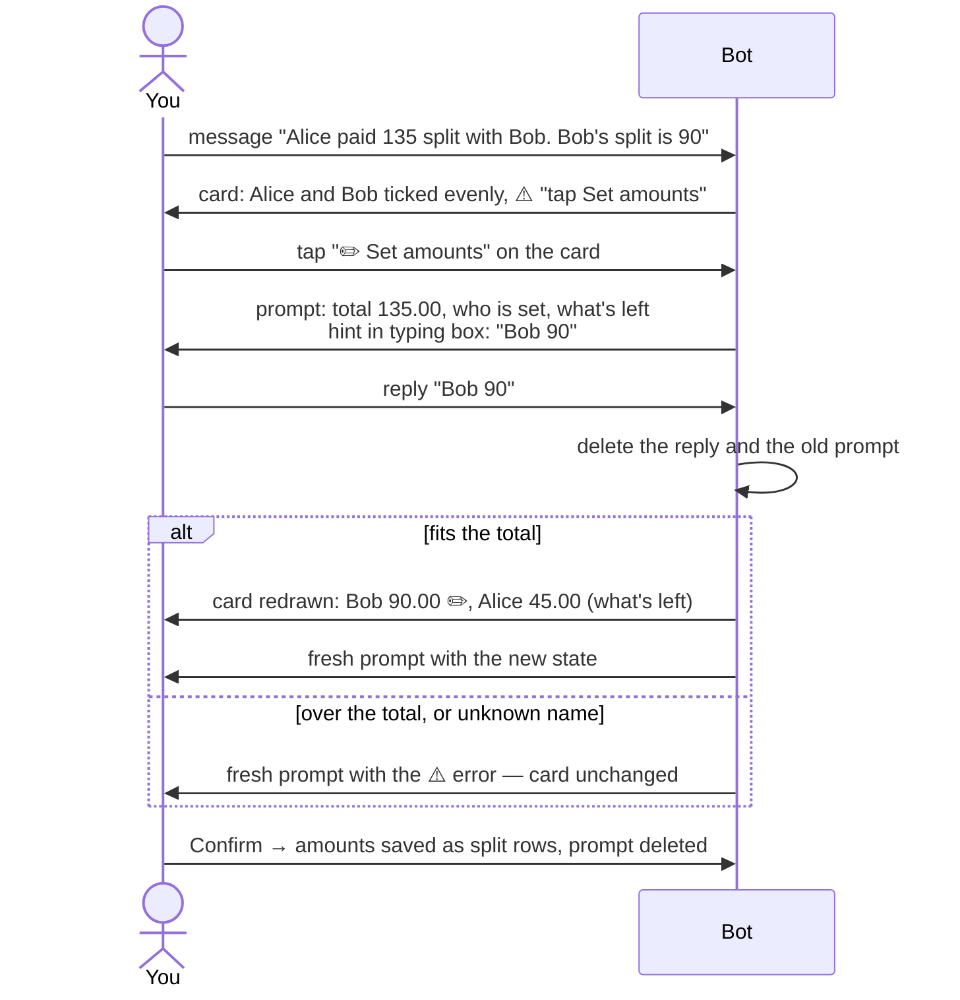

# ADR-0048: Exact split amounts, typed as a reply

**Status:** Accepted
**Date:** 2026-11-18
**Issue:** [#112](https://github.com/sujayjangam/unified-ledger-pipeline/issues/112)

## Problem

Some bills split by exact amounts ("Alice paid 135, Bob's share is 90"). Today that gets a
"can't do uneven shares yet" warning and no split.

## Decision

- **Typed, not read from the message.** Python reads the reply, no model. Names only from the
  ticked people, amounts only through `dollars_to_cents`. Commas or new lines are optional:
  "Bob 90 me rest" reads as two pairs.
- **One person at a time.** A reply sets only the people it names; later replies replace a
  person's amount. Anyone not set shares what's left, evenly or by their counts when the
  message had counts. So the card always adds up and Confirm always works.
- **`rest`** puts a person back into the group sharing what's left. It goes in the `/help` split
  topic.
- **The only error is a misfit:** set amounts over the total, nobody left to take a remainder,
  or someone left with nothing. That reply changes nothing.
- **"Set amounts" is one tap away** once 2+ people are ticked: beside "Change split" on the
  card, and first in the split menu. Often the names are right and only the shares are wrong.
- **Ticking keeps the amounts.** A new person joins what's left; unticking drops their amount.
  An open prompt is replaced to match (a ForceReply message can't be edited), and deleted
  when fewer than two are ticked.
  Only a tick change that leaves a misfit clears them, with a ⚠️ line, and the next prompt
  shows the old amounts.
- **One prompt on screen.** Each reply and the old prompt are deleted once read (bots can
  delete incoming messages in private chats within 48 hours); the error goes in the fresh
  prompt. Confirm or Cancel deletes the last prompt. The expense message stays. A failed delete
  is ignored and never blocks a save.
- **Same rules as every card button:** the card lock, answer once, never load the directory,
  redraw from a copy. The reply is caught before expense extraction, like payback amounts.
- **Names read, shares not: tick them anyway.** A fixed share or percentage in the message, or
  "uneven" with no count, ticks the names read as an even split, with a ⚠️ line pointing to
  "Set amounts". Every count the model read is dropped (it reads "share is 50" as a count of
  50). The warning doesn't block Confirm, so an unfixed card saves even shares. Splits by
  count (nights) are unchanged.
- **A share sentence is part of its expense.** The model read "… Bob's split is 90" as a second
  expense in 3 of 8 runs, so the one-expense guard refused it. The prompt now says a share
  belongs to its cost (12/12 after); `check_extraction` fails on a wrong expense count and keeps
  two real expenses as two, ready for several expenses per message.
- **Only cents are saved.** No migration.

## Rejected

- **The model reads amounts from the message:** more ways to misread, and more Python checks to
  catch it. Typing them is exact.
- **A Mini App with input boxes:** needs a hosted page and login checks.
- **Every person in one reply, total must match:** first trial on the test bot (2026-11-18)
  piled up messages and needed a full retype for every change.
- **Clear all amounts on any tick change:** they still fit when the new person takes what's left.
- **No split for a fixed share until ticked by hand:** the names were already right; it cost
  three taps to tick them again.
