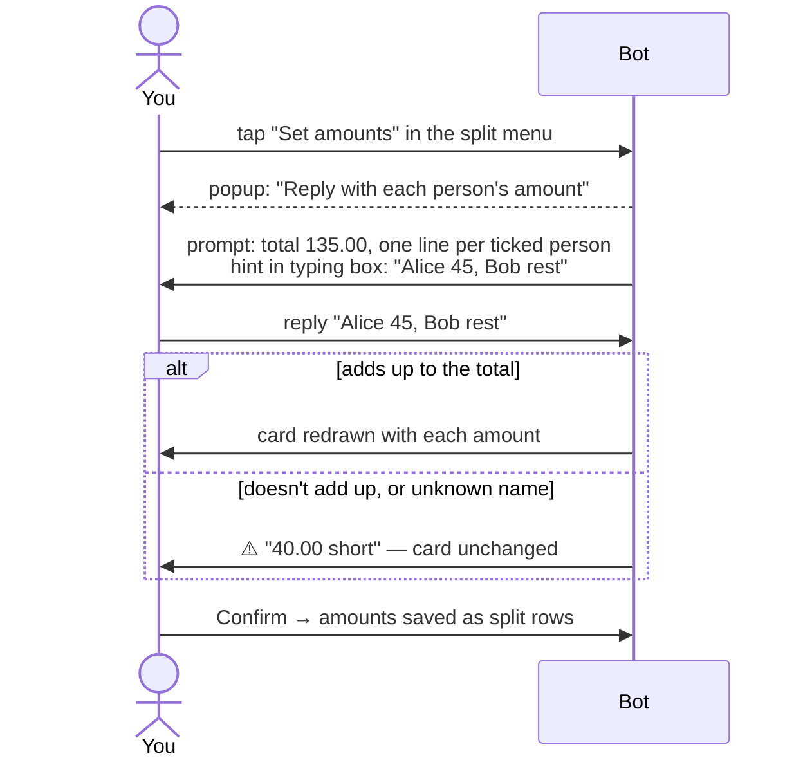

# ADR-0048: Exact split amounts, typed as a reply

**Status:** Proposed
**Date:** 2026-11-18
**Issue:** [#112](https://github.com/sujayjangam/unified-ledger-pipeline/issues/112)

## Problem

Some bills split by exact amounts ("Alice paid 135, Bob's share is 90"). Today that gets a
"can't do uneven shares yet" warning and no split.

## Decision

- **Typed, not read from the message.** Python reads the reply: names matched against the
  ticked people, amounts through `dollars_to_cents`, lines or commas. No model.
- **`rest`** gives one person whatever is left. It goes in the `/help` split topic.
- **Must add up exactly.** Otherwise a ⚠️ reply with the difference, and nothing changes.
- **Ticking or unticking clears the amounts.** The card falls back to an even split with a ⚠️
  "amounts cleared, set them again" line until Confirm, and the next prompt shows the old
  amounts.
- **Same rules as every card button:** the card lock, answer once, never load the directory,
  redraw from a copy. The reply is caught before expense extraction, like payback amounts.
- **Only cents are saved.** No migration. The "can't do uneven shares yet" warning now points to
  "Set amounts".

## Rejected

- **The model reads amounts from the message:** more ways to misread, and more Python checks to
  catch it. Typing them is exact.
- **A Mini App with input boxes:** needs a hosted page and login checks.
- **Keep old amounts after a tick change:** they'd no longer add up to the total.
