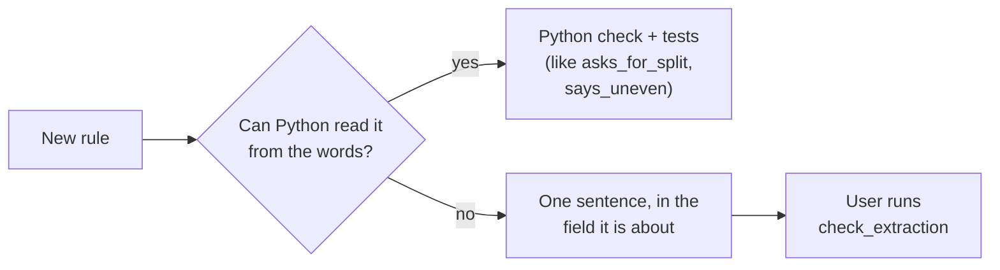

# ADR-0049: The prompt holds only what Python can't read

**Status:** Accepted
**Date:** 2026-11-18
**Issue:** [#120](https://github.com/sujayjangam/unified-ledger-pipeline/issues/120)
**Code:** `app/services/extraction.py`, `app/services/splits.py::says_uneven`,
`tests/test_extraction.py`

## Problem

The extraction prompt nearly doubled while splits were built, and price-first amounts started
slipping soon after. Much of the text was developer notes, indentation, repeats, a dead field,
or rules Python already enforces.

## Decision

- Every class docstring on the schema models is sent to the model, so notes go in `#`
  comments. The strings carry no indentation.
- Each rule appears once, in its field. The system prompt keeps only the account list and the
  rules measured needing both copies ("ytd", the bare-number price).
- `needs_review` is gone (nothing read it). `uneven` is read by Python (`says_uneven`): it only
  ever added a card warning.
- `tests/test_extraction.py` caps the size, so growth is a deliberate change.

Evidence: about 12,600 characters per request down to 8,300. The real-model run is pending,
done by the user before merging; its results go in the PR.

## Rejected

- **Trim only the whitespace:** the repeats and dead rules were most of the growth.
- **Drop the measured repeats too:** "ytd" failed in 3 of 10 runs with one copy.
- **Keep `uneven` as a model field:** it can't be tested offline, and the words settle it.
