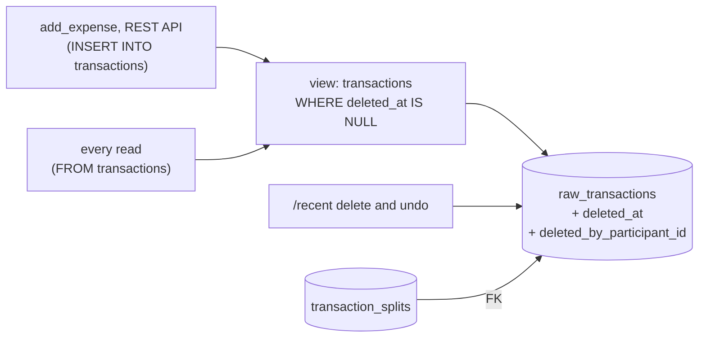

# ADR-0050: Deleted entries are marked, and a view hides them

**Status:** Proposed
**Date:** 2026-11-18
**Issue:** [#115](https://github.com/sujayjangam/unified-ledger-pipeline/issues/115)
**Code:** `alembic/versions/0010_*`, `app/services/ledger_queries.py`, `app/bot_core.py::recent_command`, `docs/LOCAL_TESTING.md` (test-entry purge query)

## Problem

A confirmed entry can't be undone from Telegram. A deleted entry must leave the totals,
`/trip_bals` and the duplicate check, yet stay recoverable: Neon's point-in-time recovery only
covers 6 hours.

## Decision

- The table is renamed `raw_transactions` and gains `deleted_at` (NULL = live) and
  `deleted_by_participant_id`. A view named `transactions` shows only live rows, with the old
  columns, so no existing query, insert or join changes.
- Only the delete and undo queries name `raw_transactions`. Delete sets `deleted_at`; undo
  clears it. Nothing is moved, so nothing can be half-moved.
- Split rows stay where they are. Every reader joins them to `transactions`, so a deleted
  entry's shares drop out with it. Foreign keys follow the rename to the real table.
- A deleted row keeps its `idempotency_key`, so a late retry of its Confirm can't bring it back.
  The unique index is on the real table, so the retry still conflicts; it returns no row through
  the view, and `add_expense` reads that as "already saved". The bot says saved, and the entry
  stays deleted: the delete was deliberate.
- Test entries are hard-deleted from `raw_transactions` by a written-down query, run by hand in
  the Neon console, never an app path; the split rows still cascade.
- Any household member may delete any entry. Undo is a button on the same card, until the card
  is redrawn; after that a deleted entry never shows in `/recent` again.
- Delete and undo are Telegram only. The REST API and CLI stay add-only: there is nobody to ask
  "are you sure?", the same reason they refuse a closed account.
- A new column goes on `raw_transactions`, then into the view's column list.
  `CREATE OR REPLACE VIEW` can only add columns at the end, so dropping, renaming or retyping a
  column means dropping and recreating the view in the same migration.
- The rename and the view are created in one migration, so `transactions` always exists. Old
  code reading `transactions` reads the view, so the migration can be applied before the merge.
- The migration is tried on a Neon branch before production: an insert through the view must
  still take `ON CONFLICT (idempotency_key) DO NOTHING`, report its row count, and get the
  `created_at` default.

## Rejected

- **Hard delete:** can't be undone, and a later payback-to-bill link (#113) would block it.
- **`deleted_at` filtered in every query:** each new query is one forgotten filter from
  counting a deleted bill.
- **Move the row to a separate deleted table:** two schemas to keep in step, the split rows
  need their own copy (they cascade), and a payback linked to the bill would have to move too.
- **A view under a new name (`live_transactions`):** every query changes, for no gain.
