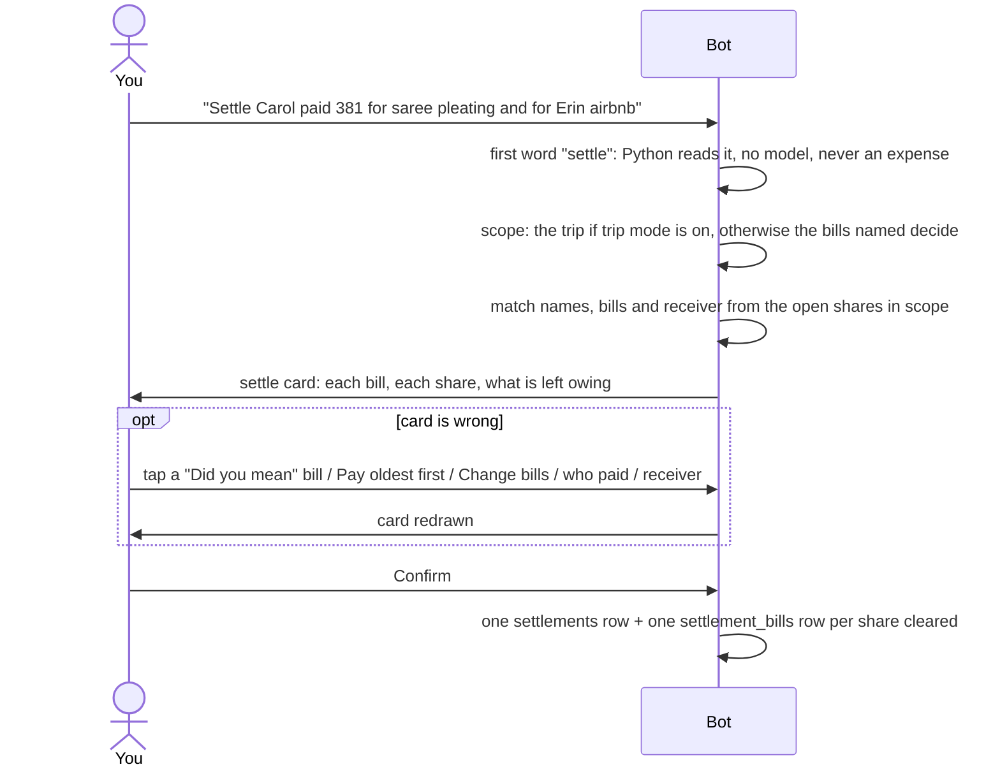

# ADR-0052: Settling up any bill by a typed "settle" message, linked to the bills it clears

**Status:** Accepted
**Date:** 2026-11-19
**Issue:** [#134](https://github.com/sujayjangam/unified-ledger-pipeline/issues/134) (takes in
[#113](https://github.com/sujayjangam/unified-ledger-pipeline/issues/113) and
[#114](https://github.com/sujayjangam/unified-ledger-pipeline/issues/114))
**Code:** `alembic/versions/0011_*`, `app/services/settle.py`, `app/services/settle_card.py`,
`app/bot_core.py::handle_settle_up_button`, `app/services/balances.py::open_bill_shares`
**Changes:** in [ADR-0046](0046-settlements-as-their-own-records.md), "Taps first" (a typed
message comes first; the "Mark paid" buttons stay until a "Settle up" button replaces them). The
rest of ADR-0046, ADR-0047 and ADR-0051 stays.

## Problem

A payback today takes one "Mark paid" tap per line, works only on a trip, and doesn't record
which bill it was for. One real payment often covers several bills and several people, so it
takes many taps, and the record can't show a bill as paid off.

## Decision



### One method for every bill

- **Any bill, trip or everyday.** The reader, the matching, the card and `settlement_bills` are
  the same for every bill. Only the scope differs. The planned `/bals` (everyday debts) reuses
  all of it; the report itself is a separate issue.
- **Debts per bill, per person.** Every share is a debt from the sharer to the bill's payer.
  Rolling up to families is only how `/trip_bals` shows and suggests payments (ADR-0051); it
  never decides which bill a payback clears.
- **Scope.** Trip mode on: only that trip's bills, nothing else. Trip mode off: the bills named
  decide. A trip bill makes it that trip's payback, an untagged bill an everyday one (`trip_id`
  empty). With no bill named and trip mode off, only everyday debts count. One message can't
  mix a trip bill and an everyday bill, or bills on two trips: a payback has one trip.
- **"Settle everyday bills instead"** is a per-card switch, like the expense card's "Not trip".
  It shows only in trip mode, when a bill word matched no trip bill but did match an everyday
  bill. A tap redraws this card with everyday bills; trip mode stays on, so later expenses are
  still tagged. Both sets of bills are read with the message, so the tap loads nothing.

### Reading the message

- **"Settle" as the first word** (any case, punctuation after it ignored, so a voice note's
  "Settle, …" works) sends the message down its own path, before expense extraction. It is never
  saved as an expense, so the money can't be counted twice.
- **Read by Python, no model call.** "X paid N" gives who handed over the money ("I" or "me" is
  the sender) and the amount, through `dollars_to_cents`, in the bills' currency unless a
  currency is said. Names and family labels are matched like a split: the trip's members in a
  trip, otherwise every participant.
- **Each "for …" part** splits into names and bill words:
  - bill words only ("for saree pleating"): the payer's own share of that bill;
  - names and bill words ("for Erin airbnb", "for airbnb for the Ngs and Carol"): those people's
    shares of that bill;
  - names only ("for the Ngs"): those people's whole debt to the receiver;
  - no "for" at all ("Settle Dave paid 1942"): the payer's own debt only.
- **The receiver is whoever paid the matched bills.** With no bill named, it is the one person
  they owe; if they owe more than one, the card asks with a button per person. A typed message
  has one receiver: bills paid by two different people need one settle message each.

### Matching a bill

Candidates are the bills in scope where those people still owe a share. Bill words are compared
with the bill's saved description, after dropping "the", "a", "an", "my", "our", "his", "her" and
"their". Hyphens and case are ignored, and so is a trailing "s" (bed = beds). Whole words only.

1. **Full match:** every bill word is in the description. That bill is ticked. Several full
   matches are all ticked, with "⚠️ 2 bills matched".
2. **Close match:** some of the bill words are in the description, and the money left for that
   part equals an open share on the bill, or the bill's total. The oldest close match is ticked,
   and the card says "❓ Did you mean …?" with one button per close match (date and total on
   each, so two Airbnbs can be told apart), a "Pay oldest first" button, and Change bills.
3. **No match:** the money goes to those people's oldest bills first, with a ⚠️ line. The
   exception: in trip mode, when the words match an everyday bill, no trip bill is ticked (it
   would clear a bill nobody meant). The card shows the "Settle everyday bills instead" button
   and Change bills, and no Confirm until a bill is ticked.

An amount with no word in common is no match: common amounts (20, 50) would pick the wrong bill.

| Settle says | Bill description | Result |
|---|---|---|
| "for the airbnb" | "Airbnb 2300 on my Visa, 5 nights" | Full match |
| "for saree pleating" | "saree pre-pleating 381" | Full match ("pre-pleating" is two words) |
| "for beds" | "bed frame 330" | Full match |
| "for car" | "car rental 300" and "Grab car 20" | Full match, both ticked, ⚠️ "2 bills matched" |
| "paid 120 for saree draping" | "saree pre-pleating 381", Carol's share 120 | Close match: "saree" is in it and 120 is the share |
| "for car" | "carpark 5" | No match (whole words only) |
| "for air bnb" | "Airbnb 2300" | No match |
| "for hotel" | "Airbnb 2300" | No match (no synonyms) |
| "for dinner yesterday" | "Dinner 480 cash" | No match ("yesterday" isn't in it), unless 480 or a share fits: then close |
| "for airbnd" (typo) | "Airbnb 2300" | No match |

### Where the money goes

- **In order.** Named bills in the order said; inside one part, and with no bill named, oldest
  bill first. Old paybacks with no bill rows count as clearing a line's oldest bills first.
  Anything past the named shares is an overpayment (ADR-0046's warning and button).
- **A new table, `settlement_bills`** (migration 0011, additive): `settlement_id`,
  `transaction_id` (→ `raw_transactions`, since a foreign key can't point at the view),
  `for_participant_id` (whose share) and `cents`. Each row clears that person's share of that
  bill, owed to **the bill's payer**. One payback is one `settlements` row with one bill row per
  share it clears. `_pay_back` takes each bill row off its own line; anything left over is owed
  back to the giver, as now. Old paybacks keep working unchanged.
- **No `ON DELETE` cascade.** Bills are only soft-deleted (ADR-0050), so the foreign key never
  fires in normal use. A bill row on a deleted bill clears nothing: its cents count as left over,
  owed back to the giver. The hand-run test-row cleanup in `docs/LOCAL_TESTING.md` removes bill
  rows first.
- **A payment along a simplified line** (#129, offered only by the "Settle up" button) clears
  bills on both lines. Dave owes Carol 40, Carol owes Alice 40, Dave owes Alice 60, and Dave pays
  Alice 100: rows clear Dave's 60 of Alice's bills, Carol's 40 of Alice's bills (on Carol's
  behalf), and Dave's 40 of Carol's bills (by offset, no money moved). Rows owed to a middle
  person must equal the rows paying that person's debts on their behalf, so money still moves
  only along existing debt lines (ADR-0051). Every bill ends up marked paid.
- **On someone's behalf, never "gift".** A share paid for someone else says "paid on Erin's
  behalf". As in ADR-0051, it clears their debt and nobody owes the giver.

### The card

- **Same rules as the expense card:** nothing saved until Confirm, the card lock, answer once,
  redraw from a copy, buttons carry an index into the snapshot kept on the pending card, never a
  name, and a tap never loads the directory or the bills again. Callback data stays under 64
  bytes.
- **"Clears all in full" only when every share is fully cleared.** Otherwise each line says what
  it leaves owing. ⚠️ and ❓ lines never block Confirm (the one exception is under "No match").
- **The title shows the scope:** "· Beach trip" or "· Everyday".
- **Nice to have, later:** with trip mode off, each bill row and "Did you mean" button shows a
  one-word trip label, the first word of the trip's name ("Sydney wedding trip 2026" →
  "Airbnb 2300 · Sydney · 12 Nov"). No migration.
- **One "Settle up" button** on `/trip_bals`, and later `/bals`, opens this same card, after the
  typed path ships and if time allows.
- **Every settle wording here goes into `/help`** and into the settle reader's tests. Settle is
  read with no model, so these examples are unit tests, not `scripts/check_extraction.py` cases.

### Screens

Fictional people: Tans (Alice, Bob), Lees (Carol, Dave), Ngs (Erin, Frank). Sender is Alice.

All matched, all cleared:

```
🤝 Settle up · Beach trip
Carol pays Alice $381.00
 • Saree pleating: Carol's share $120.00, cleared
 • Airbnb: Erin's share $261.00, cleared (paid on Erin's behalf)
Clears all in full.
[✅ Confirm] [❌ Cancel]
[Change bills] [Change who paid] [Change receiver]
```

Short payment ("Clears all in full" is left out):

```
 • Airbnb: Erin's share $280.00, $261.00 paid, $19.00 still owed
```

Close match, two bills could fit ("Settle Carol paid 261 for airbnb booking"):

```
🤝 Settle up · Beach trip
Carol pays Alice $261.00
 • Airbnb 2300 (12 Nov): Carol's share $261.00, cleared
❓ Did you mean this bill? 2 bills could fit.
[✅ Airbnb 2300 · 12 Nov] [Airbnb 900 · 14 Nov]
[Pay oldest first]
[✅ Confirm] [❌ Cancel]
[Change bills] [Change who paid] [Change receiver]
```

Tapping the other bill moves the tick and the money to it. "Pay oldest first" drops the guess and
shares the money over the oldest bills, as in a no match.

In trip mode, a word that matched only an everyday bill ("Settle Bob paid 330 for bed"):

```
🤝 Settle up · Beach trip
Bob pays Alice $330.00
❓ "bed" matched an everyday bill, not a trip bill.
[Settle everyday bills instead]
[Change bills] [❌ Cancel]
```

A tap redraws it as the everyday card below.

No match:

```
⚠️ No bill matched "pleating". Used Carol's oldest bills. Check.
```

Everyday payback ("Settle Bob paid 330 for bed", trip mode off):

```
🤝 Settle up · Everyday
Bob pays Alice $330.00
 • Bed frame 330: Bob's share $330.00, cleared
Clears all in full.
```

Owes more than one person, no bill named ("Settle Dave paid 1942"):

```
🤝 Settle up · Beach trip
Dave pays $1,942.00. Dave owes Alice and Bob. Who got it?
[Alice $1,500.00] [Bob $700.00]
[❌ Cancel]
```

Overpaid:

```
⚠️ $40.00 more than the shares named. Alice will owe it back to Carol.
[⚠️ Confirm overpayment] [❌ Cancel]
```

Change bills: one row per open share owed to the receiver by the people on the card, in scope,
ticked rows first, tap to toggle; the money is shared out again in the same order.

```
Which bills does Carol's $381.00 pay?
[✅ Saree pleating · Carol $120.00]
[✅ Airbnb · Erin $280.00]
[   Dinner 21 Nov · Carol $45.00]
[⬅️ Back to card]
```

Refused, nothing saved:

```
Settle needs who paid and how much, e.g. "Settle Carol paid 381".
These bills were paid by Alice and Bob. Send one settle message for each.
These bills are on a trip and outside it. Send one settle message for each.
These bills are on two trips. Send one settle message for each.
```

## Rejected

- **Buttons only:** a payment covering three people and two bills took several passes.
- **The model reads the settle message:** costs a call, and "X paid N for Y" is worded like an
  expense, so a misread counts money twice; Python can read this fixed shape.
- **Trip payback only while trip mode is on:** everyday bills are split too, and `/bals` needs the
  same method.
- **Everyday bills in scope while trip mode is on, without a tap:** a trip settle-up could clear
  an unrelated bill.
- **A button that turns trip mode off:** every expense logged after it would be untagged until
  trip mode is turned back on; the per-card switch avoids resending without that.
- **A plain amount clears what the sender picks later:** leaves money unassigned; oldest first
  is the usual meaning, and Change bills fixes it.
- **The sender is always the receiver:** wrong when the payer of the bills was someone else.
- **Match on the amount alone:** common amounts would pick the wrong bill.
- **Fuzzy word matching (typos, synonyms):** guesses; "Did you mean" and Change bills are cheaper.
- **One payback row per bill:** one handover of money would show as several paybacks.
- **A simplified payment as several paybacks:** only one handover happened; the bill rows on both
  lines record it exactly.
