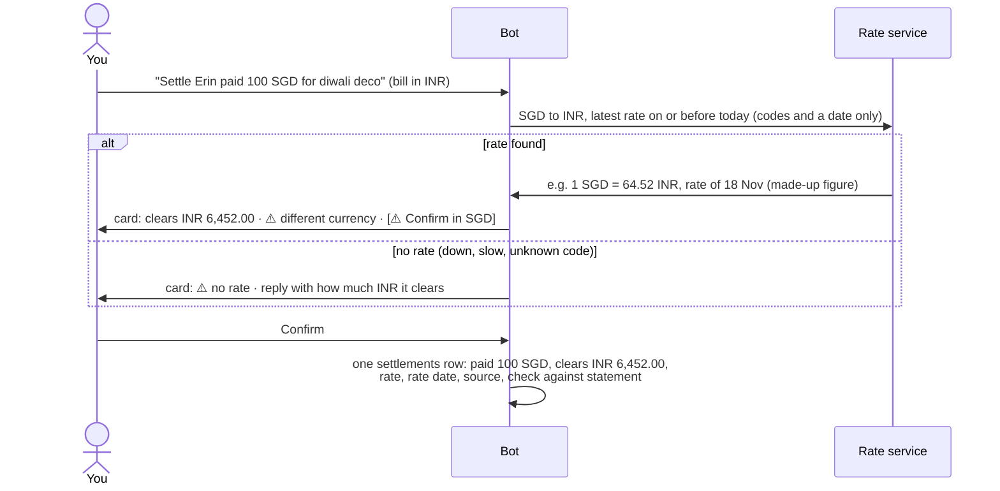

# ADR-0053: A payback in another currency is converted at a reference rate, then checked against the statement

**Status:** Accepted
**Date:** 2026-11-19
**Issue:** [#138](https://github.com/sujayjangam/unified-ledger-pipeline/issues/138) (part of
[#134](https://github.com/sujayjangam/unified-ledger-pipeline/issues/134))
**Code:** `alembic/versions/0011_*` (rate columns), `app/services/fx.py`,
`app/bot_core.py::_settle_message` and `_settle_up_reply`
**Changes:** [ADR-0046](0046-settlements-as-their-own-records.md) rejected "converting
currencies at a market rate". That stays true for "Mark paid", where both amounts are typed; the
typed settle message
([ADR-0052](0052-settle-up-by-typed-message.md)) now converts. Balances still never convert.

## Problem

On a trip the bills are in the local currency, but people pay each other back in the home
currency of the person owed (SGD, for someone who lives in Singapore). "Settle Erin paid 100 SGD
for diwali deco" on a bill of 7,260 INR can't say how much of the bill it clears, so the settle
message can't take most of a trip's paybacks.

## Decision

- **Only when the currencies differ.** The settle message's currency differs from the bills'
  currency. A payback in the bills' currency is unchanged, with no lookup.
- **The rate is a stand-in.** It works out `clears_cents` in the bills' currency from the
  money handed over. Then the payback is shared out over the bills as in ADR-0052: short leaves
  "still owed", over gets the overpayment warning. Whole cents, rounded half up (ADR-0028).
- **One rate per payback:** the latest on or before the payback date (SGT), with its date on the
  card, since reference rates skip weekends and holidays. The statement check corrects it later.
- **Loud, never silent.** The card says "⚠️ Paid in SGD, the bill is in INR. 100 SGD ≈
  INR 6,452.00 at the rate of 18 Nov. Check against the statement." Confirm reads "⚠️ Confirm in
  SGD" ("⚠️ Confirm overpayment in SGD" when both apply). "Change amount cleared" takes a typed
  reply, read by `parse_settlement_amount`, for a rate the two people agreed. Each bill and
  share on the card stays in the bill's own currency; only the money handed over is in SGD.
- **A failed lookup never blocks.** One call, a short timeout, made when the message is read,
  never on a tap. On failure the card asks for the amount cleared as a reply, as "Mark paid"
  does; no Confirm until it's given. A day's rate is kept in memory once fetched, so only the
  first lookup of a pair each day waits on the network.
- **Speed is measured before merge.** On the test bot (run locally; there is no staging Cloud Run), time the
  lookup and the whole settle message to card, first and later lookups of the day. The timeout
  is set from those numbers. Production is timed once more right after the deploy, with a
  cancelled card. The numbers go in the PR and
  [#137](https://github.com/sujayjangam/unified-ledger-pipeline/issues/137).
- **Stored on `settlements`** (nullable, additive, in migration 0011): `fx_rate` (bills'
  currency per 1 of the paid currency, NUMERIC), `fx_rate_date`, `fx_source` ("frankfurter" or
  "typed"), and `needs_statement_check` (true for every two-currency payback). The reconciliation
  engine sets it false once the bill's real rate is known from the card statement.
- **What leaves the bot:** two currency codes and a date. No names, amounts or descriptions.
- **Source:** Frankfurter (free reference rates, no API key). Checked 2026-11-19:
  `api.frankfurter.dev/v1/currencies` lists AUD, IDR, INR and SGD. Tests stub it; `tests/` never
  touches the network.

## Amended 2026-11-22: one rate per trip for "All in SGD" ([#171](https://github.com/sujayjangam/unified-ledger-pipeline/issues/171))

- The "All in SGD" screen (ADR-0056, amended) uses one rate per currency per trip, kept in
  `trip_fx_rates`, not a rate per payback day: a group settles a finished trip at the rate it
  agreed.
- Until someone types the rate the group really used (a ✏️ button, a ForceReply prompt
  recognised by its fixed first line, no model), it is the ECB reference rate on the trip's last
  day (today, while the trip is on), looked up once when the screen is first opened and stored.
  A typed rate more than 25% from the ECB one is refused as a likely
  wrong-way-round entry.
- Each payback saved from that screen stores the rate on `settlements` as before
  (`fx_source` "frankfurter" or "typed"), with `needs_statement_check` false: the rate was
  agreed, not taken from a card.
- Bills still stay in their own currency; only the screen and the paybacks convert.

## Rejected

- **Refuse another currency:** most trip paybacks are in SGD, so settling up wouldn't work on the
  trip.
- **The sender types what it clears every time:** nobody at a till knows the rate.
- **Convert the bills to SGD:** every balance would move with the rate; the statement gives each
  bill's real SGD later.
- **A rate per bill, from its date:** several rates on one card, for a figure the statement
  check replaces anyway.
- **A paid rate API:** another secret to manage, and the free one covers the currencies needed.
- **YouTrip's own rates:** no public API found (checked 2026-11-19); YouTrip shows them only in
  its app, and says they are mid-market. Its real rate reaches the ledger through the statement
  check instead.
- **Convert "Mark paid" too:** its two typed amounts already record what was agreed.
