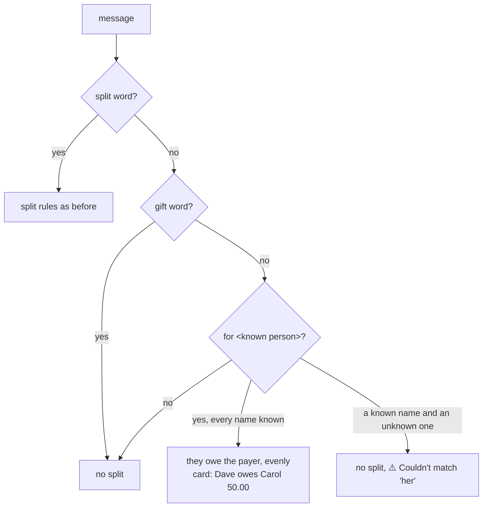

# ADR-0054: A cost paid "for" someone means they owe it

**Status:** Accepted
**Date:** 2026-11-21
**Issue:** [#154](https://github.com/sujayjangam/unified-ledger-pipeline/issues/154)
**Code:** `app/services/splits.py::resolve_split`, `read_for_people`, `_for_list`, `_people_named`

## Problem

"Carol paid 50 for Dave's ticket" was saved as Carol's own cost: "for" isn't a split word
([ADR-0039](0039-splits-read-by-the-model-worked-out-by-python.md)), so nobody owed her. The
debt had to be ticked by hand in the split menu.

## Decision

- **Python reads it, no model.** It runs only when the split rules found nobody and the
  message has no split word, so every split read today stays exactly as it was. No prompt
  change.
- **Who counts:** a participant or trip family after "for" or "on behalf of" ("for Dave's
  ticket", "for Carol and Dave", "for the Reds"). "For me", "for my haircut" and "on my
  behalf" mean the sender. Names match as split names do (`match_person`, then trip labels).
- **Not a person, so no debt:** a name nobody has ("for dinner", "for Zed"), a relative
  ("for Dave's mum"), and "paid for by Carol" (the payer). A gift word anywhere (gift,
  present, treat, birthday) means nobody owes.
- **Nothing half-charged.** A list with a known and an unknown name ("for her and Dave")
  records no split and says which name failed. After a comma, an unknown word just ends the
  list ("Taxi for Dave, 30"), and so does a plain thing after a thing ("for Dave's flight and
  hotel" is Dave's).
- **The card shows it, one tap undoes it.** A debt read this way is an ordinary split row:
  "Remove split" or the split menu changes it. A list naming only the payer is no split.

Evidence: a read-only count of production on 2026-11-21 found "for <a known person>" in 4 of
53 entries. 3 were ticked by hand as owed in full, none used a gift word, and 1 was a relative
("cake for X's mum").

## Rejected

- **Only an explicit "owes" word:** has to be remembered, and missed the real messages above.
- **Ask on every card (owed or gift?):** a tap on every entry for the common case.
- **A prompt rule for the model:** Python reads the words exactly, and prompt rules have cost
  other readings before ([ADR-0049](0049-prompt-holds-only-what-python-cant-read.md)).
