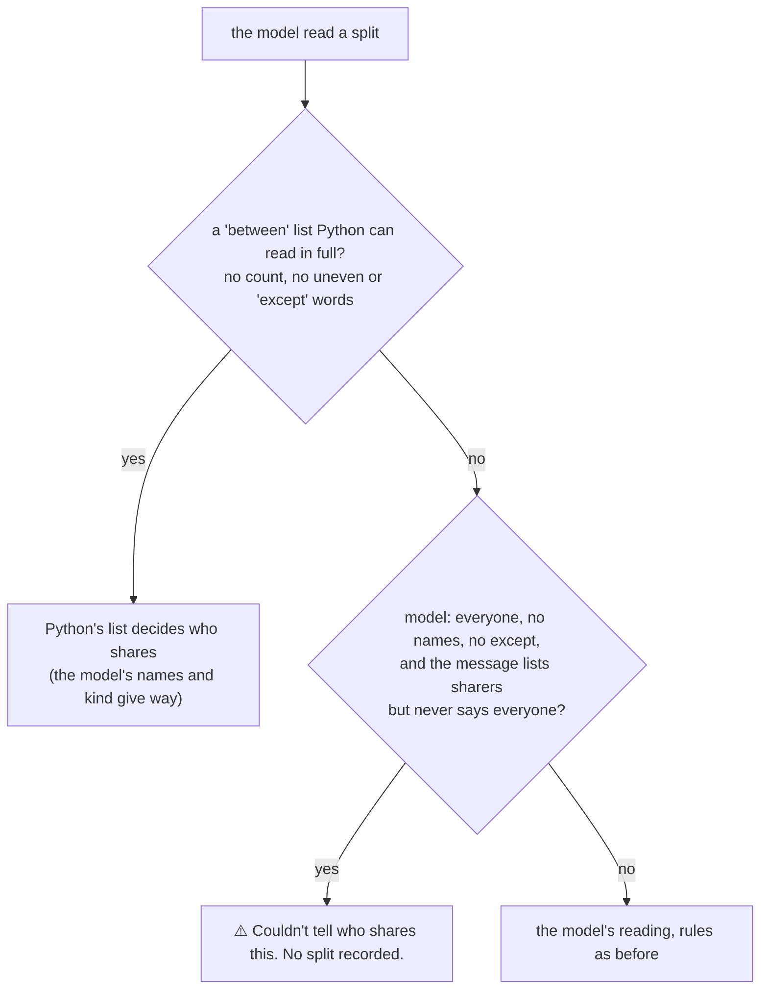

# ADR-0055: A "between" list is read by Python first

**Status:** Accepted
**Date:** 2026-11-21
**Issue:** [#158](https://github.com/sujayjangam/unified-ledger-pipeline/issues/158)
**Code:** `app/services/splits.py::read_split_list`, `::_read_reference`

## Problem

"Split between Reds" came back from the model as the whole trip, and "Split between Blues" with
the payer added as a sharer. The model never sees the trip's names or family labels, so it
guesses which words are people, and Python had no check on either reading
([ADR-0039](0039-splits-read-by-the-model-worked-out-by-python.md)).

## Decision

- **Python first, the model second**, as for the payer
  ([ADR-0040](0040-model-as-second-reader-for-the-payer.md)). Each item after "between",
  "among" or "amongst" must be a known person, family, trip label or "me", matched as a "for"
  list is ([ADR-0054](0054-paid-for-someone-means-they-owe.md)). One unknown item, a name
  running on into a word that may be another name ("Ann Kim" when only Ann Lee is known), a
  known name after the list, or "Carol's place" (an owner, not a sharer) leaves the model's
  reading.
- **"Between" only.** It lists the sharers in full, so the payer shares only if listed. "Carol
  paid 90, split with Bob" may mean Carol and Bob, so "with" stays with the model.
- **Narrow on purpose.** Python never starts a split the model didn't read ("taxi between the
  hotel and the airport"), and a split by count keeps today's reading.
- **"Everyone" with no names** needs an everyone word when the message lists who shares. A
  bare "split dinner 80" on a trip still means the whole trip, and "split except Dave" everyone
  but Dave.
- A first slice of the Python-only split reader planned for after the trip
  ([#122](https://github.com/sujayjangam/unified-ledger-pipeline/issues/122)).

Evidence: 3 real calls on 2026-11-21 (temperature 0). Two "between" messages came back as
"everyone" with no names, one of them over 95% sure; the third added the payer. Python reads all
three right from the words.

## Rejected

- **A prompt rule:** the prompt holds only what Python can't read
  ([ADR-0049](0049-prompt-holds-only-what-python-cant-read.md)), and a prompt rule once cost the
  nights readings ([ADR-0048](0048-exact-split-amounts-by-reply.md)).
- **Sending the model the trip's names:** a longer prompt, still a guess, and real names in
  every call.
- **Reading "with" lists too:** who "with" adds is unclear when someone else paid.
