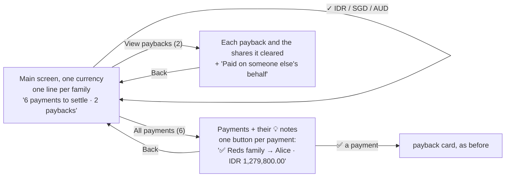

# ADR-0056: `/trip_bals` shows one currency per screen, with payments and paybacks behind buttons

**Status:** Accepted
**Date:** 2026-11-21
**Issues:** [#148](https://github.com/sujayjangam/unified-ledger-pipeline/issues/148),
[#153](https://github.com/sujayjangam/unified-ledger-pipeline/issues/153),
[#114](https://github.com/sujayjangam/unified-ledger-pipeline/issues/114)
**Code:** `app/services/balances.py::trip_balance_lines`, `::trip_payment_lines`,
`::trip_payback_lines`, `::payment_button_label`; `app/bot_core.py::_bals_screen`

## Problem

On a trip with bills in three currencies, `/trip_bals` was one message holding every
currency's families, every member under each family, every payment, 💡 notes, past paybacks,
and a column of "Mark paid 1..N" buttons for all currencies. Nobody could find who owes whom.
Separately, a payback made on someone else's behalf showed only as "on behalf of", with no
record of which shares it cleared or what each family had been paid for (#153).

## Decision

- **One currency per screen.** It opens on the currency with the most payments to settle (ties
  go alphabetically). A row of currency buttons switches between them, each showing how many
  payments are open. After a payback, the new report opens on that payback's currency.
- **One line per family**, its total only. People know who is in their family; the payments
  still go person to person where ADR-0051 says so.
- **Payments behind "All payments"**, each button naming its payment (#114). Its callback keeps
  the payment's number in the whole trip, so the payback card and older reports' buttons are
  unchanged. A 💡 note sits on the same screen as its payment, so each shortcut shown keeps its
  note (ADR-0051).
- **Paybacks behind "View paybacks"**: each one, and under it each bill share it marked paid
  ("nothing cleared" for a row that cleared nothing). Old paybacks with no bill rows say so.
  Then "Paid on someone else's behalf": what each giver paid for each family other than their
  own, counted from what really came off each debt, so money owed back to the giver is never
  in it. An offset row on a shortened line counts against the middle person, who gained and
  gave up the same amount (ADR-0052). This is #153's view: plain
  text that can be forwarded to people without the bot, read-only, nothing new stored.
- Plain text and money through `format_money`, as on the settle card. The maths
  (`unit_balances`, `trip_payments`, shortcuts) is unchanged.

Evidence: on a fictional 10-person, 4-family trip, the main screen went from 45 lines and 13
buttons to 9 lines and 3 buttons (`tests/test_bals_screens.py`).

## Rejected

- **Converting every currency into one:** balances stay per currency with no FX conversion;
  only a payback in another currency uses a reference rate
  ([ADR-0053](0053-other-currency-paybacks-at-a-reference-rate.md)).
- **Members under each family, shortened when too long:** the old fallback, which still left
  every currency and every button in one message.
- **A shared Google Sheet for #153 before the trip:** needs credentials on Cloud Run and a new
  dependency. It stays planned for after the trip.
- **Formatting (`parse_mode`, collapsed quotes):** part of #143, after the trip.
