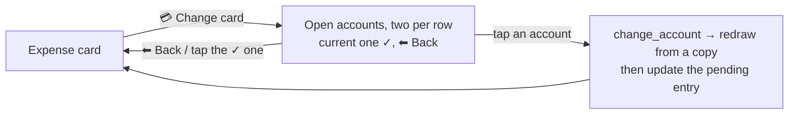

# ADR-0057: A "Change card" button picks the account on the card, and becomes the account a payer tap starts from

**Status:** Accepted
**Date:** 2026-11-21
**Issue:** [#161](https://github.com/sujayjangam/unified-ledger-pipeline/issues/161)
**Code:** `app/services/participants.py::change_account`; `app/bot_core.py::handle_card_button`,
`::_card_accounts`, `::_card_keyboard`

## Problem

If a message forgot to name the card, or the default card was wrong, the only fix was Cancel
and send the message again, with another model call. "Change who paid"
([ADR-0038](0038-paid-by-button-starts-from-the-message.md)) moves the payer, but nothing
picked the card itself.

## Decision

- **The menu lists every open account** in the directory snapshot kept on the pending entry,
  in name order. Never "Paid by someone else": that is reached only by naming an outside payer
  ([ADR-0037](0037-paid-by-person-read-from-text.md)). Callback data is the account id.
- **The payer follows the card:** an owned card makes its owner the payer; an unowned one
  (Cash, the wallet) keeps a household payer, otherwise the sender.
- **The tapped card becomes `base_account_id`**, so a later "Change who paid" starts from it
  and the two buttons don't undo each other.
- **A tap is deliberate:** no payer warning, and an open card clears the closed-card warning.
  The split stays as ticked.
- **Same rules as the payer button:** card lock, answer once and last, toast only on resolved
  cards, never load the directory, redraw from a copy. No button on a YouTrip top-up.

Evidence: `tests/test_change_card.py` (rules, stale ids, resolved cards, failed redraw, a
Confirm arriving mid-redraw).

## Rejected

- **An Edit button that re-reads corrected text (#66):** bigger, needs another model call, and
  parked.
- **Keeping the message's account as the payer tap's start:** a payer tap after a card tap
  would put the old card back.
