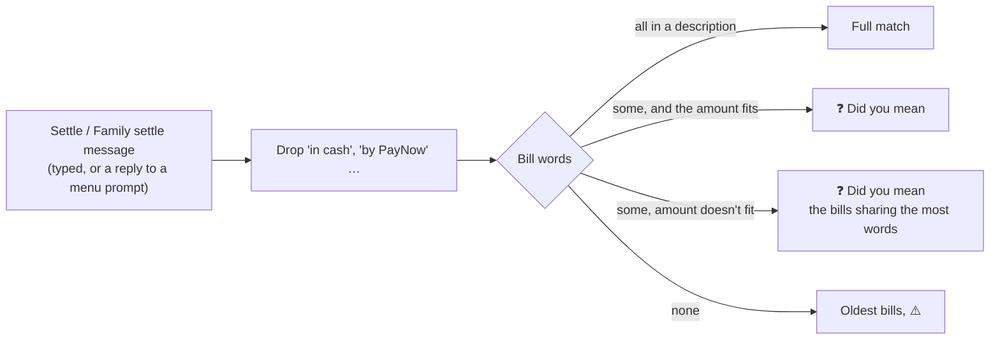

# ADR-0058: A settle message ignores how it was paid, asks about the closest bill, and "family settle" pays the whole family

**Status:** Accepted
**Date:** 2026-11-21
**Issue:** [#160](https://github.com/sujayjangam/unified-ledger-pipeline/issues/160)
**Refines:** [ADR-0052](0052-settle-up-by-typed-message.md) (bill matching rule 3, and who a
part with no names pays for)
**Code:** `app/services/settle.py::read_settle`, `::_drop_methods`, `::match_bills`,
`::settle_up`, `::family_people`; `app/services/settle_card.py::build_settle_card`;
`app/bot_core.py::handle_text`, `::_load_settle_snapshot`

## Problem

On the real trip, "Settle <name> paid 500000 idr in cash for white rock bill that overran" was
refused: only "to <person>" could follow the amount. With that fixed, "bill that overran" isn't
in the bill's description, so ADR-0052 sent the money to the oldest bills, usually the wrong
one. And one person paying for their whole family had to name every member.

## Decision

- **How it was paid is ignored.** A fixed list (cash, card, bank transfer, transfer, PayNow,
  PayLah, Wise, Revolut, YouTrip), with or without "in", "by", "via" and the like, is dropped
  from the payment clause. In a "for" part it is dropped only with that leading word, because
  bill descriptions often say "cash". A span that names a known person is never dropped.
  Anything else is still refused. Nothing is stored.
- **The closest bill is asked about, never guessed.** When no bill has every word and no
  amount fits, the bills sharing the most words become a "❓ Did you mean" question with
  buttons (oldest ticked). "bill", "that", "which", "this", "was" and "is" never count. No word
  in common is still no match.
- **"himself", "herself", "themselves"** in a "for" part mean whoever paid; "myself" means the
  sender.
- **"Family settle"** chosen per payment: a part that names nobody pays the giver's family on
  the trip, giver first. Named people always win. Families come from the card's snapshot, never
  the database on a tap. Everyday bills have no families: the giver's shares only, with a ⚠️
  line. The card's title says which kind, and one button switches between the two.
- **Menu buttons** "🤝 Settle" and "👪 Family settle" send a reply prompt. A reply is
  recognised by the prompt's fixed first line, not by memory, so after a restart it still can't
  reach the model as an expense. The prompt decides the kind. The prompt is deleted; the reply
  stays, as the settle message.

Evidence: the reported message, replayed offline with fictional names: refused before; now it
asks about the White Rock bill, and as a family settle clears both shares with no overpayment
(`tests/test_settle_words.py`).

## Rejected

- **Typo or synonym matching:** still whole words only (ADR-0052).
- **A designated family payer per trip:** needed a migration and `/trip` screens; the user chose
  to pick family or single per payment.
- **Keeping the oldest-bills fallback when words overlap:** it cleared bills nobody meant.
