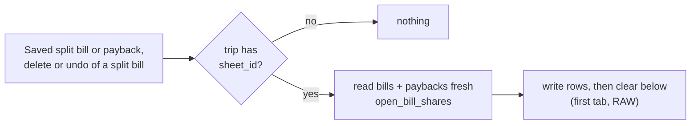

# ADR-0059: Each trip can have its own Google Sheet, rewritten after every change to its split bills or paybacks

**Status:** Accepted
**Date:** 2026-11-22
**Issue:** [#167](https://github.com/sujayjangam/unified-ledger-pipeline/issues/167)
**Code:** `app/services/trip_sheet.py::sheet_rows`, `::refresh_trip_sheet`;
`app/services/trips.py::trip_sheet_target`; migration `0012_trip_sheet_id`

## Problem

On a trip, people pay each other back one bill at a time, but the bot shows only netted lines
(`/trip_bals`) and the paybacks entered. Nobody could see which bills were paid and which were
still owed, or which paybacks were never entered, without scrolling Telegram.

## Decision

- **One workbook per trip** (`trips.sheet_id`, nullable), so one trip's people never see
  another trip's bills. A trip with no sheet works as before, with no Google call.
- **One row per bill, before netting:** who paid, each sharer's share (✅ when paid), paid
  back, still owed, status. The numbers come from `open_bill_shares`, the same maths as
  `/trip_bals` and the settle card.
- **Rewritten in full after each change**, never edited cell by cell and never read back. It
  runs after the card already says saved, one write at a time per trip; a failure is only
  logged and never touches the save. It is awaited inside the request, because Cloud Run gives
  CPU only while a request is open.
- **No new secret or library:** on Cloud Run the bot writes as its own service account (the
  metadata server's token); the test bot acts as that account through gcloud.
- **RAW values:** descriptions are raw user text, so nothing typed can run as a formula.

Evidence: a spike on 2026-11-21 wrote to a test workbook both locally (gcloud acting as the
service account) and from a Cloud Run job running as it.

## Rejected

- **A snapshot file sent in Telegram:** goes stale the moment anyone pays.
- **One shared workbook with a tab per trip:** every trip's people could see every trip.
- **A service-account key as a secret:** the Cloud Run identity already has what it needs.
- **A background task after the reply:** Cloud Run may pause its CPU, so the write could stall.
