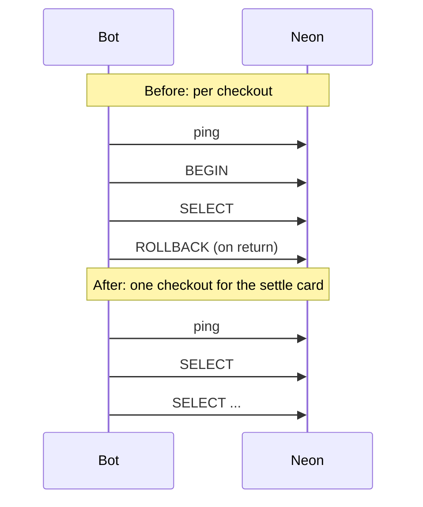

# ADR-0060: The bot's reads run in autocommit, and the settle card's loads share one connection

**Status:** Accepted
**Date:** 2026-11-22
**Issue:** [#174](https://github.com/sujayjangam/unified-ledger-pipeline/issues/174) (part of
[#173](https://github.com/sujayjangam/unified-ledger-pipeline/issues/173))

## Problem

The bot runs in Singapore and the database in Ohio, about 0.22 s per round trip. Every
connection checkout cost four round trips before its first row came back, and a typed settle
card checked out five connections. It took 6–7 s to draw, with 1 ms of real work.

Since ADR-0061 (the same day) the bot runs next to the database, at about 21 ms a round
trip. Fewer round trips still pay off, only less.

## Decision

- **The bot's reads go through `get_read_connection()`** (`app/database.py`), which runs in autocommit:
  no `BEGIN`, no `ROLLBACK`. A block uses it only if everything it runs is a `SELECT` and it
  never commits. Anything that writes or stores a value stays on `get_connection()`, and so do
  the REST API and CLI, which are out of this change.
- **Same data as before.** Postgres's default isolation, read committed, already takes a fresh
  snapshot for each statement, so a read in autocommit sees what it saw inside a transaction.
- **One connection for the settle card.** A loader takes an optional `conn=`. The settle card's
  loads share one checkout, and each loader keeps its own error handling and return values.
  `/trip_bals` still checks out per load: sharing there needs its connection scopes reworked.
- **The ping stays.** Neon's free tier suspends its compute when idle. Without the ping, a dead
  pooled connection would make the directory read fail, and the bot would refuse everyone.

Evidence (Neon test branch, from a laptop at ~0.33 s a round trip): the directory load went from
1390 to 820 ms, the settle bills with a trip on from 6637 to about 2900 ms, and with no trip
on from 12412 to 4400 ms.

## Rejected

- Autocommit for the whole engine: it would make the two-table writes, such as an entry and
  its split rows, non-atomic.
- Dropping the ping: it saves one round trip per screen, but a stale connection would lock
  everyone out mid-trip.
