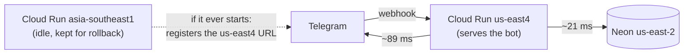

# ADR-0061: The bot runs in us-east4, next to the database

**Status:** Accepted
**Date:** 2026-11-22
**Issue:** [#175](https://github.com/sujayjangam/unified-ledger-pipeline/issues/175) (part of
[#173](https://github.com/sujayjangam/unified-ledger-pipeline/issues/173))

## Problem

Cloud Run ran in `asia-southeast1` and Neon runs in AWS `us-east-2` (Ohio). Every database
round trip took 219 ms, and every Telegram API call 234 ms. A typed settle card took 6–7 s to
draw, and fewer round trips in the code (ADR-0060) only brought it down to about 2.5 s.

## Decision

- **The bot runs on Cloud Run in `us-east4`**, with the same service name, image, secrets,
  service account and limits as before. The deploy trigger's `_DEPLOY_REGION` is `us-east4`,
  in both the trigger and its inline build.
- **The Singapore service stays, idle, as the rollback.** Its `WEBHOOK_URL` points at the
  us-east4 URL. The bot registers its webhook on every start, so a start there re-registers
  us-east4 and never takes the webhook back. With no minimum instances, idle costs nothing.
- **Rollback, in minutes:** set the Singapore service's `WEBHOOK_URL` back to its own URL (its
  next start registers it), and set the trigger's region back.
- Neon, the backups and the image registry (still in `asia-southeast1`) are unchanged.

Evidence: a probe job run in four regions (2026-11-22) measured 21 ms to Neon from `us-east4`,
against 219 ms from Singapore. A Telegram request took 89 ms against 234 ms. `us-east4` is a
Tier 1 Cloud Run region and Singapore a Tier 2 one, so the move costs no more.

## Rejected

- Moving Neon to Singapore: it means a new project and a dump and restore of production. More
  risk, and Telegram would stay slow.
- `us-east5` (Columbus): the same database time, but Telegram took 95 ms.
- A warm minimum instance for the cold start: it costs money every month, and the owner
  declined it.
