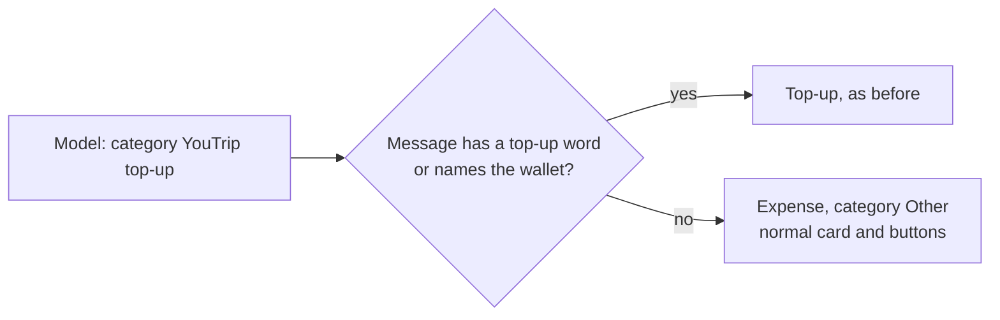

# ADR-0062: A YouTrip top-up counts only when the message says "top up" or names the wallet

**Status:** Accepted
**Date:** 2026-11-26
**Code:** `app/services/participants.py::says_top_up`, `::drop_unsaid_top_up`;
`app/bot_core.py::process_expense_text`

## Problem

The model read "Changed 500sgd to AUD for Carol" (cash from a money changer) as a YouTrip
top-up. A top-up card is a Transfer on the wallet's funding card, with no split, payer or card
buttons, so nothing on the card could fix it.

## Decision

- Whether the message says it is something Python answers exactly (as in
  [ADR-0031](0031-last-week-from-message-text.md)), so it runs before `resolve_payment`.
- Words: "top up" (any spacing or hyphen), "tops/topped/topping up", "topup", or "YouTrip".
- It only downgrades. Python never makes a top-up the model didn't read.

## Rejected

- A prompt rule: the prompt holds only what Python can't read
  ([ADR-0049](0049-prompt-holds-only-what-python-cant-read.md)), and it would need a paid run.
- "Change card" on top-up cards: still no split, and the reading would stay wrong.
